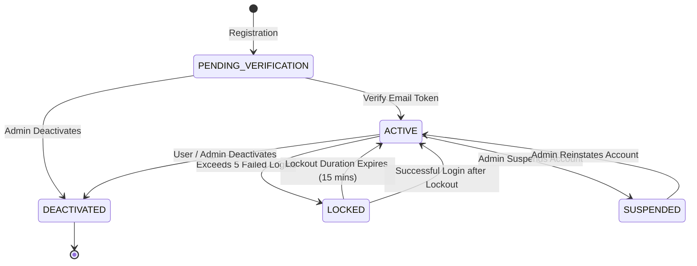

# CharityChain — Account Lifecycle Specification
**Phase 2 Deliverable — Account States, Transitions, Verification & Lockout Rules**

---

## 1. Account Lifecycle State Machine

---

## 2. Account Status Definitions

| Status | Description | Can Login? | Permitted Actions |
|---|---|:---:|---|
| `PENDING_VERIFICATION` | Initial state upon registration awaiting email token confirmation. | ❌ | Can only request resend of verification token. |
| `ACTIVE` | Normal verified account in good standing. | ✅ | Full operations allowed according to platform and organization roles. |
| `LOCKED` | Temporarily frozen due to repeated failed login attempts. | ❌ (Until expiry) | Can wait out 15-minute lockout or use password reset. |
| `SUSPENDED` | Administratively frozen due to compliance, fraud, or violation investigation. | ❌ | All active sessions revoked; access blocked. |
| `DEACTIVATED` | Permanently closed or deactivated account. | ❌ | Cannot authenticate; historic records retained for ledger integrity. |

---

## 3. Transition Rules & Authorized Actors

| Current State | Target State | Trigger / Event | Authorized Actor | Preconditions / Actions |
|---|---|---|---|---|
| None | `PENDING_VERIFICATION` | User submits registration | Public / Anonymous | Validates email syntax, password strength, creates verification token |
| `PENDING_VERIFICATION` | `ACTIVE` | Valid verification token submitted | Authenticated User | Marks `is_verified=True`, sets `email_verified_at=now` |
| `ACTIVE` | `LOCKED` | 5 consecutive failed login attempts | System (Auth Engine) | Sets `locked_until = now + 15 minutes` |
| `LOCKED` | `ACTIVE` | Lockout expiration or password reset | System / User | Clears `failed_login_attempts` and `locked_until` |
| `ACTIVE` | `SUSPENDED` | Administrative suspension | `PLATFORM_ADMIN` | Revokes all active user sessions; logs security audit event |
| `SUSPENDED` | `ACTIVE` | Administrative reinstatement | `PLATFORM_ADMIN` | Logs audit event with admin justification |
| `ACTIVE` | `DEACTIVATED` | Account closure | `PLATFORM_ADMIN` / User | Revokes all sessions; preserves donor/disbursement audit records |

