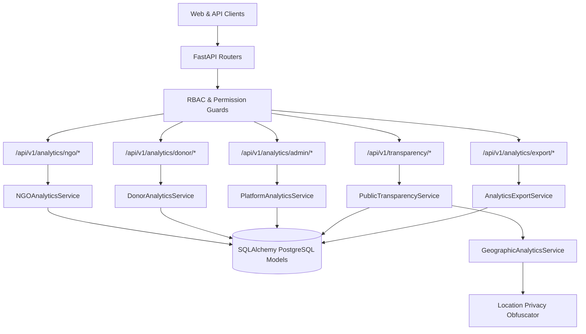

# CharityChain — Analytics & Transparency Architecture
## Decentralized Impact Intelligence, Data Lineage & Access Boundaries

- **Document Version:** 1.0.0
- **Phase:** Phase 11 (Analytics, Impact Reporting & Public Transparency)
- **Primary Package:** `backend.app.services.analytics`

---

## 1. Architectural Principles

CharityChain Phase 11 introduces a data-driven impact intelligence and public transparency system.
The architecture enforces five core invariants:

1. **Authoritative Source of Truth:**
   - Analytical calculations are executed against **PostgreSQL domain models** (`Project`, `Milestone`, `PaymentCapture`, `PaymentRefund`, `Disbursement`, `JournalLine`, `ImpactCertificate`).
   - Legacy prototype databases (such as TinyDB `data/charity.db`) are deprecated for production reporting.
2. **Integer Minor Units:**
   - All financial mathematics operate strictly in integer minor units (fiat cents) to eliminate binary floating-point rounding errors.
3. **Multi-Currency Segregation:**
   - Donated funds are categorized and reported per ISO currency code (USD, EUR, GBP), preventing improper cross-currency summations.
4. **Strict Role-Based Data Isolation:**
   - Donors can only access their own giving history.
   - NGOs can only access their own project funding, evidence, and milestone drill-downs.
   - Platform administrators access overall operational health and double-entry ledger balance.
   - Public users access only explicitly published project and transparency records.
5. **Location Privacy Protections:**
   - For sensitive projects (domestic violence shelters, child protection facilities, emergency relief outposts), exact GPS coordinates are coarsened to regional grid centroids (~16 km resolution) to protect vulnerable beneficiaries.

---

## 2. Service Architecture Map



---

## 3. Component Directory Layout

```text
backend/app/
├── services/
│   └── analytics/
│       ├── __init__.py
│       ├── metric_definitions.py          # Central metric catalog & formulas
│       ├── platform_analytics_service.py  # Platform KPIs & operational health
│       ├── ngo_analytics_service.py       # Tenant-isolated NGO analytics & reports
│       ├── donor_analytics_service.py     # Personalized donor portfolios & journeys
│       ├── transparency_service.py        # Public-safe project & NGO profiles
│       ├── geographic_analytics_service.py# Coordinates validation & privacy centroids
│       └── analytics_export_service.py    # CSV formula injection prevention
├── api/
│   └── v1/
│       ├── analytics.py                   # Role-authorized analytics endpoints
│       └── transparency.py                # Public unauthenticated transparency endpoints
└── schemas/
    └── analytics.py                       # Pydantic request & response schemas
```

