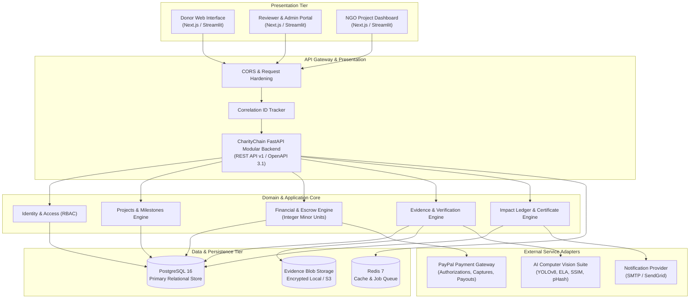
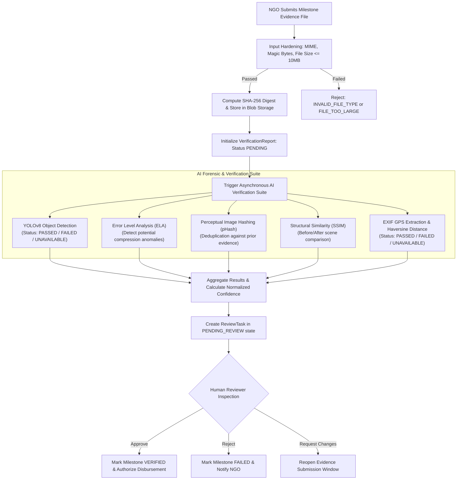
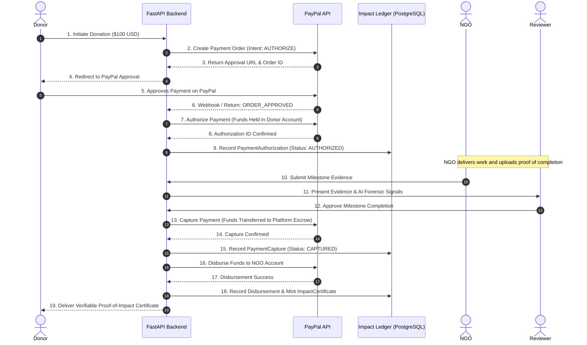

# CharityChain — System Architecture Documentation
**Phase 1 Deliverable — Production-Ready Modular Monolith Architecture**

---

## 1. Executive Summary & Core Principle

**CharityChain** is an AI-powered charitable giving and impact verification platform connecting financial contributions directly with verifiable, real-world proof of milestone completion.

### The Foundational Principle
> **"AI analyzes. Evidence supports. Humans decide. Payment systems execute. CharityChain records."**

Every architectural boundary, domain state transition, and integration in CharityChain adheres strictly to this premise:
- **No Autonomous Financial Execution**: AI models provide forensic indicators and confidence signals, but never approve payments or disbursements independently.
- **Strict Separation of Financial Stages**: Explicitly distinguishes between payment authorization, payment capture, donor refunds, and NGO disbursements. Standard payment gateway authorization is never misrepresented as smart contract escrow.
- **Cryptographic & Verifiable Accountability**: All milestone updates, evidence hashes, review decisions, and financial disbursements are permanently committed to an append-only, auditable Impact Ledger.

---

## 2. Architectural Style: Modular Monolith

CharityChain is architected as a **Modular Monolith** in FastAPI (Python 3.11+ / 3.14). This pattern provides high development velocity, operational simplicity, and strict module boundaries without the latency, network unreliability, and distributed transaction complexity of microservices.

### Bounded Contexts & Module Boundaries
```
backend/app/
├── core/                   # Cross-cutting: Config, Logging, Exceptions, Currency, State Machines
├── db/                     # Data Access: SQLAlchemy declarative base, connection pooling, migrations
│   └── models/             # Domain entities grouped by bounded context
│       ├── users.py        # Identity, Users, Organizations, NGO Profiles
│       ├── projects.py     # Projects, Milestones, Geolocation
│       ├── financial.py    # Donations, Orders, Authorizations, Captures, Refunds, Disbursements
│       ├── evidence.py     # Evidence Files, Verification Reports, Forensic Checks
│       └── reviews_impact.py # Review Tasks, Decisions, Impact Certificates, Audit Events
├── integrations/           # Port/Adapter Abstractions (Payments, AI, Storage, Notifications)
│   ├── payments/           # PayPal Orders & Disbursals, Sandbox & Live
│   ├── ai/                 # Forensic Verifiers (YOLO, ELA, pHash, SSIM, Geolocation)
│   ├── storage/            # Local & S3-compatible Blob Storage
│   └── notifications/      # Transactional Email, Webhooks
└── api/                    # Presentation Layer
    ├── v1/                 # Versioned REST endpoints
    └── schemas.py          # Envelopes, Pydantic DTOs, Serialization
```

---

## 3. High-Level System Architecture



---

## 4. Frontend vs. Backend Responsibility Boundary

### Phase 1 Coexistence Strategy
During Phase 1, the existing Python Streamlit application (`app_ui.py`) continues to provide an interactive donor, NGO, and reviewer UI. The new FastAPI modular monolith backend runs concurrently on port 8000. Subsequent phases transition the frontend to a Next.js 14+ React application.

| Capability / Concern | Streamlit (Phase 0/1 Baseline) | FastAPI Backend (Target Architecture) |
|---|---|---|
| **Role & Purpose** | Rapid prototype UI, manual operations | Scalable API, persistence, business logic |
| **State Management** | Ephemeral `st.session_state` | Stateless HTTP, JWT tokens, Redis cache |
| **Data Access** | Direct TinyDB calls (Stabilized) | SQLAlchemy 2.0 ORM, PostgreSQL connection pool |
| **Financial Math** | Float approximations | `Money` Value Object (Integer minor units, Banker's rounding) |
| **AI Invocation** | In-process synchronous execution | Asynchronous pipeline, decoupled worker interface |
| **Audit Logging** | File-based append logs | Structured JSON logging with Correlation ID & DB audit trail |

---

## 5. End-to-End Evidence Processing Pipeline



---

## 6. Financial & Payment Lifecycle Flow

CharityChain enforces strict separation between authorization, capture, escrow-holding, and disbursement:



---

## 7. Cross-Cutting Engineering Concerns

### 7.1 Security & Zero-Trust
1. **Zero Secret Hardcoding**: All secrets, database URLs, API tokens, and private keys are injected dynamically via environment variables validated by Pydantic Settings.
2. **Context Sanitization**: Logging middleware automatically redacts sensitive headers, passwords, and tokens (`***REDACTED***`).
3. **Correlation ID Tracking**: Every HTTP request receives or inherits an `X-Correlation-ID` header propagated across logs, exceptions, and audit records.

### 7.2 Currency Precision
- Financial values are strictly managed via the `Money` value object storing amounts as 64-bit integer minor units (cents) with high-precision ISO 4217 currency tracking.
- Multiplications and divisions strictly utilize Decimal Banker's Rounding (`ROUND_HALF_EVEN`) to eliminate cumulative rounding drift.

### 7.3 Auditable Impact Ledger
- All state changes impacting milestones, verifications, and disbursements write append-only records to `audit_events`.
- Records include cryptographic SHA-256 hashes of preceding records, actor UUIDs, timestamps, and before/after state snapshots.

