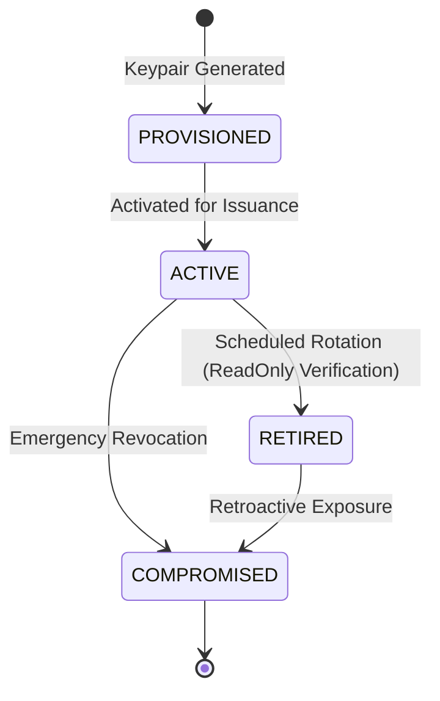

# CharityChain — Issuer Key Management & Cryptographic Security
## Ed25519 Keypair Lifecycle, Secure Storage, Key Rotation, and Compromise Runbook

---

## 1. Cryptographic Principles & Key Architecture

CharityChain uses modern asymmetric cryptography based on Edwards-curve Digital Signature Algorithm (**Ed25519**, RFC 8032) over Curve25519 to sign all **Proof-of-Impact Certificates** and **Impact Ledger Checkpoints**.

### Key Characteristics:
- **Algorithm**: `Ed25519` (`EdDSA` in JOSE / JWKS specifications).
- **Public Key Size**: 32 bytes (256 bits), Base64-encoded.
- **Private Key Size**: 32 bytes seed / 64 bytes expanded, Base64-encoded.
- **Security Strength**: Approximately 128-bit security level, resistant to side-channel timing attacks.
- **Performance**: High signing and verification throughput (>10,000 operations/sec on commodity hardware).

---

## 2. Key Lifecycle States

Keys are registered in the `issuer_signing_keys` database table and adhere to the following strict state machine:



1. **PROVISIONED**: Key generated, public key registered, private key safeguarded, but not yet signing new certificates.
2. **ACTIVE**: Exactly one key is designated as the active signer (`is_active = True`). All new certificates and ledger checkpoints are signed with this key.
3. **RETIRED**: Superseded by a newer active key. The private key is taken offline or purged from production memory. The public key remains published indefinitely in JWKS discovery to verify historical certificates.
4. **COMPROMISED**: Emergency status indicating potential or confirmed private key exposure. All certificates signed exclusively with this key during the vulnerability window are marked for governance review or revocation.

---

## 3. Key Storage & Environment Configuration

### 3.1 Development & Staging Configuration
In local development and staging environments:
- Key files can be stored in the directory designated by `SIGNING_KEY_DIR` (default: `data/keys/`).
- Private keys can be passed directly via the environment variable `SIGNING_PRIVATE_KEY_B64`.
- The active key identifier is set via `SIGNING_ACTIVE_KEY_ID`.

```env
SIGNING_ACTIVE_KEY_ID="dev-ed25519-key-1"
SIGNING_KEY_DIR="data/keys"
SIGNING_PRIVATE_KEY_B64="mc4wCAQ...=="
```

### 3.2 Production Deployment & Cloud KMS / HSM
In production environments:
1. **Never commit private keys to version control**.
2. Store the primary signing key in a certified Hardware Security Module (HSM) or managed Cloud KMS:
   - **Google Cloud KMS**: Cloud HSM asymmetric signing key (`EC_SIGN_ED25519`).
   - **AWS KMS / CloudHSM**: Asymmetric signing key pair.
   - **HashiCorp Vault**: Transit Secrets Engine with `ed25519` key type.
3. Restrict key access via IAM policies with automated audit logging on every `Sign` operation.

---

## 4. Key Rotation Procedure

To maintain forward secrecy and limit the blast radius of potential key exposure, issuer keys should be rotated on a planned annual cadence.

### Step-by-Step Rotation Runbook:

1. **Generate New Keypair**:
   Using the built-in CharityChain CLI:
   ```bash
   python -m backend.app.cli generate-issuer-key --key-id "key_2027_primary" --activate False
   ```
2. **Distribute & Provision Public Key**:
   - The CLI registers the public key in the database with status `PROVISIONED`.
   - Ensure the new public key appears in `GET /.well-known/jwks.json`.
3. **Promote New Key to Active**:
   - Update deployment environment variables:
     ```env
     SIGNING_ACTIVE_KEY_ID="key_2027_primary"
     SIGNING_PRIVATE_KEY_B64="<base64_private_key>"
     ```
   - Transition prior key in database:
     ```python
     key_mgmt_service.retire_key("key_2026_primary")
     key_mgmt_service.activate_key("key_2027_primary")
     ```
4. **Historical Continuity**:
   - All certificates previously signed by `key_2026_primary` remain completely valid because verifiers retrieve the historical key via its `kid` in the JWKS.
   - Offline verifiers using cached public keys will retrieve the new public key on their next sync.

---

## 5. Key Compromise Emergency Response Runbook

In the event of a suspected or confirmed compromise of an active or retired private key:

### Phase 1: Immediate Containment (T + 0 to 15 Minutes)
1. **Revoke Active Key Immediately**:
   Update key record status to `COMPROMISED`:
   ```python
   key_mgmt_service.mark_compromised(key_id="compromised_key_id", incident_notes="Compromise report #INC-8921")
   ```
2. **Promote Clean Key**:
   Instantly switch `SIGNING_ACTIVE_KEY_ID` to an uncompromised reserve key and restart backend application instances.
3. **Update JWKS**:
   The JWKS endpoint immediately marks the key as compromised (`"status": "COMPROMISED"`), preventing automated verifiers from accepting new claims signed by it.

### Phase 2: Audit & Impact Assessment (T + 1 Hour)
1. Query all certificates signed by the compromised key:
   ```sql
   SELECT id, certificate_number, issued_at, status 
   FROM impact_certificates 
   WHERE signature_key_id = 'compromised_key_id'
   ORDER BY issued_at DESC;
   ```
2. Cross-reference issuance timestamps against the ledger event stream:
   - Verify if any certificates exist that lack corresponding verified human review milestones in `review_decisions` or `milestone_records`.
   - Identify rogue or forged certificates.

### Phase 3: Remediation & Reissuance (T + 24 Hours)
1. Legitimate certificates issued prior to the compromise timestamp are re-signed using the new active key:
   - Issue superseding certificates with updated signatures referencing the original certificates.
2. Rogue or unverified certificates are permanently marked `REVOKED` with `reason_code = KEY_COMPROMISE`.
3. Publish an official cryptographic incident transparency disclosure to the CharityChain security portal.

