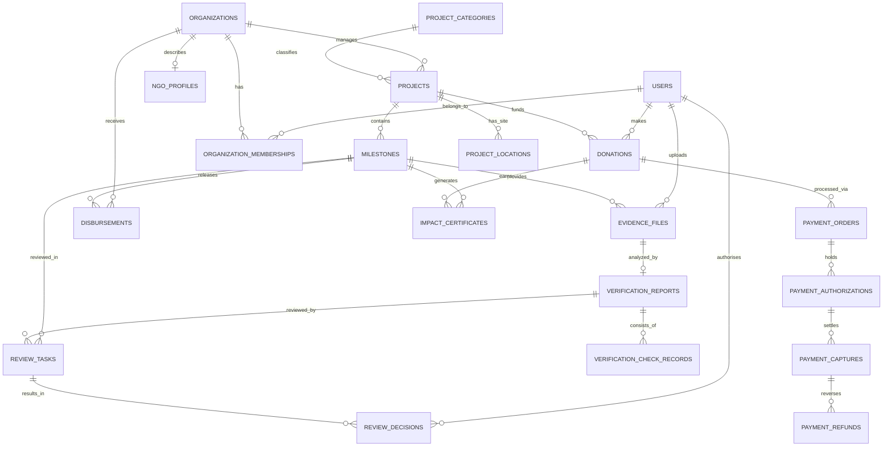

# CharityChain — Database Design Specification
**Phase 1 Deliverable — Relational Schema, Indexes, ER Diagram & Migration Plan**

---

## 1. Relational Database Overview

CharityChain uses **PostgreSQL 16** as its primary production relational database engine. All persistent records, transactional states, evidence metadata, and audit records are stored with full ACID guarantees, referential integrity, and strict data typing.

### Foundational Schema Conventions
- **Primary Keys**: UUID v4 strings stored as `VARCHAR(36)` (or native PostgreSQL `UUID`), preventing enumeration attacks.
- **Audit Columns**: Every table includes `created_at` (UTC TIMESTAMP), `updated_at` (UTC TIMESTAMP), and `is_active` (BOOLEAN).
- **Monetary Precision**: Stored as `BIGINT` representing integer minor units (e.g. cents) paired with a 3-character ISO 4217 `currency` code. Check constraints enforce `amount >= 0`.
- **Soft Deletion & Archival**: Records are deactivated via `is_active = FALSE` rather than deleted, preserving full financial and impact history.

---

## 2. Entity-Relationship (ER) Diagram



---

## 3. Relational Table Definitions

### 3.1 Identity & Organizations
```sql
CREATE TABLE users (
    id VARCHAR(36) PRIMARY KEY,
    email VARCHAR(255) NOT NULL UNIQUE,
    hashed_password VARCHAR(255) NOT NULL,
    full_name VARCHAR(255),
    role VARCHAR(50) NOT NULL DEFAULT 'DONOR',
    is_verified BOOLEAN NOT NULL DEFAULT FALSE,
    is_active BOOLEAN NOT NULL DEFAULT TRUE,
    created_at TIMESTAMP NOT NULL DEFAULT CURRENT_TIMESTAMP,
    updated_at TIMESTAMP NOT NULL DEFAULT CURRENT_TIMESTAMP
);
CREATE INDEX ix_users_email ON users(email);
CREATE INDEX ix_users_role ON users(role);

CREATE TABLE organizations (
    id VARCHAR(36) PRIMARY KEY,
    name VARCHAR(255) NOT NULL UNIQUE,
    legal_registration_number VARCHAR(100) UNIQUE,
    tax_id VARCHAR(100),
    country VARCHAR(2) NOT NULL,
    status VARCHAR(50) NOT NULL DEFAULT 'PENDING_APPROVAL',
    verification_level VARCHAR(50) NOT NULL DEFAULT 'TIER_0_UNVERIFIED',
    is_active BOOLEAN NOT NULL DEFAULT TRUE,
    created_at TIMESTAMP NOT NULL DEFAULT CURRENT_TIMESTAMP,
    updated_at TIMESTAMP NOT NULL DEFAULT CURRENT_TIMESTAMP
);
CREATE INDEX ix_organizations_status ON organizations(status);

CREATE TABLE ngo_profiles (
    id VARCHAR(36) PRIMARY KEY,
    organization_id VARCHAR(36) NOT NULL UNIQUE REFERENCES organizations(id) ON DELETE CASCADE,
    mission_statement TEXT NOT NULL,
    website_url VARCHAR(255),
    paypal_payout_email VARCHAR(255),
    verified_at TIMESTAMP,
    is_active BOOLEAN NOT NULL DEFAULT TRUE,
    created_at TIMESTAMP NOT NULL DEFAULT CURRENT_TIMESTAMP,
    updated_at TIMESTAMP NOT NULL DEFAULT CURRENT_TIMESTAMP
);
```

### 3.2 Projects & Milestones
```sql
CREATE TABLE project_categories (
    id VARCHAR(36) PRIMARY KEY,
    name VARCHAR(100) NOT NULL UNIQUE,
    slug VARCHAR(100) NOT NULL UNIQUE,
    description TEXT,
    is_active BOOLEAN NOT NULL DEFAULT TRUE,
    created_at TIMESTAMP NOT NULL DEFAULT CURRENT_TIMESTAMP,
    updated_at TIMESTAMP NOT NULL DEFAULT CURRENT_TIMESTAMP
);

CREATE TABLE projects (
    id VARCHAR(36) PRIMARY KEY,
    organization_id VARCHAR(36) NOT NULL REFERENCES organizations(id),
    category_id VARCHAR(36) REFERENCES project_categories(id),
    title VARCHAR(255) NOT NULL,
    slug VARCHAR(255) NOT NULL UNIQUE,
    description TEXT NOT NULL,
    target_amount_minor BIGINT NOT NULL CHECK (target_amount_minor > 0),
    currency VARCHAR(3) NOT NULL DEFAULT 'USD',
    status VARCHAR(50) NOT NULL DEFAULT 'DRAFT',
    beneficiary_count INTEGER NOT NULL DEFAULT 0,
    start_date DATE,
    end_date DATE,
    is_active BOOLEAN NOT NULL DEFAULT TRUE,
    created_at TIMESTAMP NOT NULL DEFAULT CURRENT_TIMESTAMP,
    updated_at TIMESTAMP NOT NULL DEFAULT CURRENT_TIMESTAMP
);
CREATE INDEX ix_projects_org ON projects(organization_id);
CREATE INDEX ix_projects_status ON projects(status);

CREATE TABLE milestones (
    id VARCHAR(36) PRIMARY KEY,
    project_id VARCHAR(36) NOT NULL REFERENCES projects(id) ON DELETE CASCADE,
    sequence_order INTEGER NOT NULL,
    title VARCHAR(255) NOT NULL,
    description TEXT NOT NULL,
    target_amount_minor BIGINT NOT NULL CHECK (target_amount_minor > 0),
    currency VARCHAR(3) NOT NULL DEFAULT 'USD',
    status VARCHAR(50) NOT NULL DEFAULT 'NOT_STARTED',
    due_date DATE,
    verified_at TIMESTAMP,
    is_active BOOLEAN NOT NULL DEFAULT TRUE,
    created_at TIMESTAMP NOT NULL DEFAULT CURRENT_TIMESTAMP,
    updated_at TIMESTAMP NOT NULL DEFAULT CURRENT_TIMESTAMP,
    CONSTRAINT uq_project_sequence UNIQUE (project_id, sequence_order)
);
CREATE INDEX ix_milestones_project_status ON milestones(project_id, status);

CREATE TABLE project_locations (
    id VARCHAR(36) PRIMARY KEY,
    project_id VARCHAR(36) NOT NULL UNIQUE REFERENCES projects(id) ON DELETE CASCADE,
    latitude DOUBLE PRECISION NOT NULL CHECK (latitude >= -90.0 AND latitude <= 90.0),
    longitude DOUBLE PRECISION NOT NULL CHECK (longitude >= -180.0 AND longitude <= 180.0),
    radius_meters DOUBLE PRECISION NOT NULL DEFAULT 1000.0,
    address_text VARCHAR(500),
    is_active BOOLEAN NOT NULL DEFAULT TRUE,
    created_at TIMESTAMP NOT NULL DEFAULT CURRENT_TIMESTAMP,
    updated_at TIMESTAMP NOT NULL DEFAULT CURRENT_TIMESTAMP
);
```

### 3.3 Financials & Payments
```sql
CREATE TABLE donations (
    id VARCHAR(36) PRIMARY KEY,
    user_id VARCHAR(36) REFERENCES users(id) ON DELETE SET NULL,
    project_id VARCHAR(36) NOT NULL REFERENCES projects(id),
    amount_minor BIGINT NOT NULL CHECK (amount_minor > 0),
    currency VARCHAR(3) NOT NULL DEFAULT 'USD',
    status VARCHAR(50) NOT NULL DEFAULT 'PENDING',
    is_anonymous BOOLEAN NOT NULL DEFAULT FALSE,
    donor_name VARCHAR(255),
    is_active BOOLEAN NOT NULL DEFAULT TRUE,
    created_at TIMESTAMP NOT NULL DEFAULT CURRENT_TIMESTAMP,
    updated_at TIMESTAMP NOT NULL DEFAULT CURRENT_TIMESTAMP
);
CREATE INDEX ix_donations_project ON donations(project_id);
CREATE INDEX ix_donations_user ON donations(user_id);

CREATE TABLE payment_orders (
    id VARCHAR(36) PRIMARY KEY,
    donation_id VARCHAR(36) NOT NULL REFERENCES donations(id),
    gateway VARCHAR(50) NOT NULL DEFAULT 'PAYPAL',
    gateway_order_id VARCHAR(100) NOT NULL UNIQUE,
    intent VARCHAR(50) NOT NULL DEFAULT 'AUTHORIZE',
    amount_minor BIGINT NOT NULL,
    currency VARCHAR(3) NOT NULL DEFAULT 'USD',
    status VARCHAR(50) NOT NULL DEFAULT 'CREATED',
    expires_at TIMESTAMP,
    is_active BOOLEAN NOT NULL DEFAULT TRUE,
    created_at TIMESTAMP NOT NULL DEFAULT CURRENT_TIMESTAMP,
    updated_at TIMESTAMP NOT NULL DEFAULT CURRENT_TIMESTAMP
);
CREATE INDEX ix_payment_orders_gateway_id ON payment_orders(gateway_order_id);

CREATE TABLE payment_authorizations (
    id VARCHAR(36) PRIMARY KEY,
    order_id VARCHAR(36) NOT NULL REFERENCES payment_orders(id),
    gateway_auth_id VARCHAR(100) NOT NULL UNIQUE,
    amount_minor BIGINT NOT NULL,
    currency VARCHAR(3) NOT NULL DEFAULT 'USD',
    status VARCHAR(50) NOT NULL DEFAULT 'CREATED',
    expiration_date TIMESTAMP,
    is_active BOOLEAN NOT NULL DEFAULT TRUE,
    created_at TIMESTAMP NOT NULL DEFAULT CURRENT_TIMESTAMP,
    updated_at TIMESTAMP NOT NULL DEFAULT CURRENT_TIMESTAMP
);

CREATE TABLE payment_captures (
    id VARCHAR(36) PRIMARY KEY,
    authorization_id VARCHAR(36) NOT NULL REFERENCES payment_authorizations(id),
    gateway_capture_id VARCHAR(100) NOT NULL UNIQUE,
    amount_minor BIGINT NOT NULL,
    net_amount_minor BIGINT,
    fee_amount_minor BIGINT,
    currency VARCHAR(3) NOT NULL DEFAULT 'USD',
    status VARCHAR(50) NOT NULL DEFAULT 'COMPLETED',
    is_active BOOLEAN NOT NULL DEFAULT TRUE,
    created_at TIMESTAMP NOT NULL DEFAULT CURRENT_TIMESTAMP,
    updated_at TIMESTAMP NOT NULL DEFAULT CURRENT_TIMESTAMP
);

CREATE TABLE disbursements (
    id VARCHAR(36) PRIMARY KEY,
    milestone_id VARCHAR(36) NOT NULL REFERENCES milestones(id),
    organization_id VARCHAR(36) NOT NULL REFERENCES organizations(id),
    amount_minor BIGINT NOT NULL CHECK (amount_minor > 0),
    currency VARCHAR(3) NOT NULL DEFAULT 'USD',
    gateway_payout_batch_id VARCHAR(100),
    status VARCHAR(50) NOT NULL DEFAULT 'PENDING_APPROVAL',
    executed_at TIMESTAMP,
    is_active BOOLEAN NOT NULL DEFAULT TRUE,
    created_at TIMESTAMP NOT NULL DEFAULT CURRENT_TIMESTAMP,
    updated_at TIMESTAMP NOT NULL DEFAULT CURRENT_TIMESTAMP
);
CREATE INDEX ix_disbursements_milestone ON disbursements(milestone_id);
```

### 3.4 Evidence, Verification, Impact & Audit
```sql
CREATE TABLE evidence_files (
    id VARCHAR(36) PRIMARY KEY,
    milestone_id VARCHAR(36) NOT NULL REFERENCES milestones(id),
    uploader_id VARCHAR(36) NOT NULL REFERENCES users(id),
    file_name VARCHAR(255) NOT NULL,
    mime_type VARCHAR(100) NOT NULL,
    file_size_bytes BIGINT NOT NULL,
    storage_path VARCHAR(500) NOT NULL,
    sha256_hash VARCHAR(64) NOT NULL UNIQUE,
    phash VARCHAR(64),
    latitude DOUBLE PRECISION,
    longitude DOUBLE PRECISION,
    exif_metadata JSONB,
    is_active BOOLEAN NOT NULL DEFAULT TRUE,
    created_at TIMESTAMP NOT NULL DEFAULT CURRENT_TIMESTAMP,
    updated_at TIMESTAMP NOT NULL DEFAULT CURRENT_TIMESTAMP
);
CREATE INDEX ix_evidence_milestone ON evidence_files(milestone_id);
CREATE INDEX ix_evidence_sha256 ON evidence_files(sha256_hash);

CREATE TABLE verification_reports (
    id VARCHAR(36) PRIMARY KEY,
    evidence_file_id VARCHAR(36) NOT NULL UNIQUE REFERENCES evidence_files(id) ON DELETE CASCADE,
    overall_confidence DOUBLE PRECISION NOT NULL DEFAULT 0.0,
    status VARCHAR(50) NOT NULL DEFAULT 'PENDING',
    is_tampered_indicator BOOLEAN NOT NULL DEFAULT FALSE,
    summary TEXT,
    is_active BOOLEAN NOT NULL DEFAULT TRUE,
    created_at TIMESTAMP NOT NULL DEFAULT CURRENT_TIMESTAMP,
    updated_at TIMESTAMP NOT NULL DEFAULT CURRENT_TIMESTAMP
);

CREATE TABLE verification_check_records (
    id VARCHAR(36) PRIMARY KEY,
    report_id VARCHAR(36) NOT NULL REFERENCES verification_reports(id) ON DELETE CASCADE,
    check_type VARCHAR(50) NOT NULL,
    status VARCHAR(50) NOT NULL DEFAULT 'PENDING',
    score DOUBLE PRECISION,
    details JSONB,
    is_active BOOLEAN NOT NULL DEFAULT TRUE,
    created_at TIMESTAMP NOT NULL DEFAULT CURRENT_TIMESTAMP,
    updated_at TIMESTAMP NOT NULL DEFAULT CURRENT_TIMESTAMP
);

CREATE TABLE review_tasks (
    id VARCHAR(36) PRIMARY KEY,
    milestone_id VARCHAR(36) NOT NULL REFERENCES milestones(id),
    report_id VARCHAR(36) NOT NULL REFERENCES verification_reports(id),
    status VARCHAR(50) NOT NULL DEFAULT 'PENDING_REVIEW',
    assigned_reviewer_id VARCHAR(36) REFERENCES users(id),
    is_active BOOLEAN NOT NULL DEFAULT TRUE,
    created_at TIMESTAMP NOT NULL DEFAULT CURRENT_TIMESTAMP,
    updated_at TIMESTAMP NOT NULL DEFAULT CURRENT_TIMESTAMP
);

CREATE TABLE review_decision_records (
    id VARCHAR(36) PRIMARY KEY,
    task_id VARCHAR(36) NOT NULL REFERENCES review_tasks(id),
    reviewer_id VARCHAR(36) NOT NULL REFERENCES users(id),
    decision VARCHAR(50) NOT NULL,
    notes TEXT NOT NULL,
    decided_at TIMESTAMP NOT NULL DEFAULT CURRENT_TIMESTAMP,
    is_active BOOLEAN NOT NULL DEFAULT TRUE,
    created_at TIMESTAMP NOT NULL DEFAULT CURRENT_TIMESTAMP,
    updated_at TIMESTAMP NOT NULL DEFAULT CURRENT_TIMESTAMP
);

CREATE TABLE impact_certificates (
    id VARCHAR(36) PRIMARY KEY,
    donation_id VARCHAR(36) NOT NULL REFERENCES donations(id),
    milestone_id VARCHAR(36) NOT NULL REFERENCES milestones(id),
    certificate_number VARCHAR(100) NOT NULL UNIQUE,
    sha256_digest VARCHAR(64) NOT NULL,
    token_units INTEGER NOT NULL DEFAULT 0,
    issued_at TIMESTAMP NOT NULL DEFAULT CURRENT_TIMESTAMP,
    is_active BOOLEAN NOT NULL DEFAULT TRUE,
    created_at TIMESTAMP NOT NULL DEFAULT CURRENT_TIMESTAMP,
    updated_at TIMESTAMP NOT NULL DEFAULT CURRENT_TIMESTAMP
);

CREATE TABLE audit_events (
    id VARCHAR(36) PRIMARY KEY,
    entity_name VARCHAR(100) NOT NULL,
    entity_id VARCHAR(36) NOT NULL,
    action VARCHAR(50) NOT NULL,
    actor_id VARCHAR(36),
    before_state JSONB,
    after_state JSONB,
    correlation_id VARCHAR(100),
    created_at TIMESTAMP NOT NULL DEFAULT CURRENT_TIMESTAMP,
    is_active BOOLEAN NOT NULL DEFAULT TRUE,
    updated_at TIMESTAMP NOT NULL DEFAULT CURRENT_TIMESTAMP
);
CREATE INDEX ix_audit_entity ON audit_events(entity_name, entity_id);
CREATE INDEX ix_audit_correlation ON audit_events(correlation_id);
```

---

## 4. Alembic Migration Strategy

Database changes are managed via declarative revisions in `backend/alembic/versions/`:
- **Current Version**: `001_initial_schema.py` establishes the complete baseline relational schema.
- **Migration Execution**:
  ```bash
  alembic upgrade head
  ```
- **Downgrade Safety**: Every migration script must supply a fully reversible `downgrade()` function matching foreign key constraints in reverse topological order.

---

## 5. Transition Plan: TinyDB to PostgreSQL

To migrate existing production and demo records from `data/charity.db`:
1. **Extraction**: Script reads existing tables (`milestones`, `donations`, `verifications`, `nfts`).
2. **Entity Mapping**:
   - `milestone` records -> `projects` + `milestones`
   - `donations` records -> `donations` + `payment_orders`
   - `verifications` records -> `evidence_files` + `verification_reports`
   - `nfts` records -> `impact_certificates`
3. **Data Sanitization**:
   - Convert floating-point dollar amounts to integer cents (`round(amount * 100)`).
   - Generate deterministic UUIDs for entities using `uuid5(NAMESPACE_URL, legacy_id)`.
4. **Verification**: Row count and checksum parity checks confirm zero data loss before deprecating the TinyDB store.

