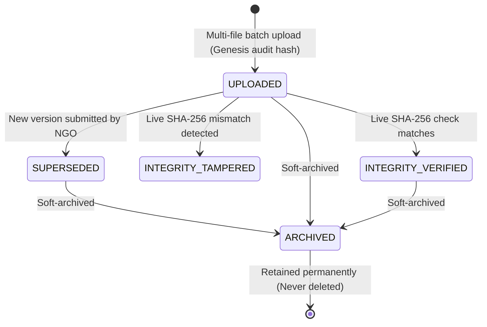

# Evidence Management System Specification

## 1. Executive Summary

CharityChain's **Evidence Management System (EMS)** serves as the tamper-evident proof foundation connecting real-world charitable milestone progress with donor contributions. It provides end-to-end management for photos, inspection documents, and receipts submitted by verified Non-Governmental Organizations (NGOs).

Phase 5 establishes a secure, unified storage and provenance layer that ensures:
1. **Multi-File Secure Ingestion**: NGOs can submit batches of evidence with strict magic-byte validation and sanitization.
2. **Pluggable Storage Providers**: Unified support for local disk storage, Amazon S3, and S3-compatible object stores (MinIO).
3. **Cryptographic Deduplication**: Fast SHA-256 content addressing preventing redundant file storage on the same milestone.
4. **Non-Destructive Versioning**: History is never overwritten. If an NGO submits an updated photo or revised lab report, the original asset is superseded while remaining intact and auditable.
5. **Tamper-Evident Audit Chains**: Every evidence action (`UPLOADED`, `INTEGRITY_VERIFIED`, `VERSION_CREATED`, `DOWNLOADED`, `ARCHIVED`, `SUPERSEDED`) is bound into a continuous cryptographic SHA-256 hash chain.
6. **Soft Archival**: Assets can be flagged as archived without destroying physical bytes or altering historical records.

---

## 2. Scope & Phase Boundaries

To ensure architectural integrity, Phase 5 strictly respects product roadmap boundaries:

| Capability | Phase 5 Status | Scope Boundary & Future Handoff |
| :--- | :--- | :--- |
| **Storage & Ingestion** | **Fully Implemented** | Local, AWS S3, and MinIO storage adapters with short-lived presigned URLs. |
| **Cryptographic Integrity** | **Fully Implemented** | Streaming SHA-256 checksums, duplicate detection, and live verification. |
| **Audit Hash Chaining** | **Fully Implemented** | Mathematical SHA-256 ledger chaining each event to prior event hash. |
| **Multi-Versioning** | **Fully Implemented** | Non-destructive replacement with parent-child linkage. |
| **AI Evidence Verification** | **Deferred to Phase 6** | YOLOv8 object detection, error level analysis (ELA), perceptual hashing (pHash), and EXIF GPS verification are deferred to Phase 6. |
| **Human Review Sign-Off** | **Deferred to Phase 7** | Reviewer assignment, review decision queues, and dispute workflows belong to Phase 7. |
| **Financial Disbursements** | **Deferred to Phase 8** | Conditional milestone fund release to NGO payout methods belongs to Phase 8. |
| **Decentralized Storage** | **No Unsupported Claims** | No false claims of public blockchain or IPFS immutability. Provenance is enforced through cryptographic SHA-256 audit hash chains. |

---

## 3. Data Model Architecture

The evidence lifecycle is governed by two core SQLAlchemy models:

### `EvidenceFile`
Represents an individual evidence asset uploaded for a milestone.
- `id` (UUID): Primary key.
- `milestone_id` (UUID, Foreign Key): Milestone to which this evidence belongs.
- `uploader_id` (UUID, Foreign Key): Active user who submitted the file.
- `file_path` (String): Internal access URL or object path.
- `file_hash` (String 64): Cryptographic SHA-256 checksum of raw file bytes.
- `content_address` (String 128): Deterministic address formatted as `sha256:<hash>`.
- `mime_type` (String 64): Declared MIME type.
- `detected_mime_type` (String 100): MIME type validated via magic bytes signature.
- `file_size_bytes` (Integer): Exact byte length.
- `status` (`EvidenceStatus`): `UPLOADED`, `PROCESSING`, `PROCESSED`, `FAILED`, `ARCHIVED`.
- `original_filename` (String 255): Sanitized original file name.
- `storage_key` (String 500): Canonical key within storage provider (e.g. `milestones/{id}/{hash[:16]}_{filename}`).
- `storage_provider` (String 50): Active backend (`local`, `s3`, `minio`).
- `storage_version_id` (String 100, Optional): Object version ID when S3 versioning is enabled.
- `version_number` (Integer, Default 1): Monotonically increasing version index.
- `parent_evidence_id` (UUID, Foreign Key, Optional): Reference to earlier version in the lineage.
- `is_archived` (Boolean, Default False): Soft-archival flag.
- `archived_at` (DateTime, Optional): Timestamp of archival.

### `EvidenceAuditEvent`
Tamper-evident audit ledger tracking every action performed on an evidence asset.
- `id` (UUID): Primary key.
- `evidence_id` (UUID, Foreign Key): Evidence asset reference.
- `actor_id` (UUID, Foreign Key, Optional): User performing the operation (or system).
- `event_type` (String 50): `UPLOADED`, `INTEGRITY_VERIFIED`, `INTEGRITY_TAMPERED`, `VERSION_CREATED`, `SUPERSEDED`, `DOWNLOADED`, `ARCHIVED`.
- `details_json` (JSON): Canonical metadata payload, including `timestamp`.
- `previous_event_hash` (String 64): Hash of the immediately preceding audit event (`"0" * 64` for genesis).
- `current_event_hash` (String 64): SHA-256 of `(previous_event_hash, evidence_id, actor_id, event_type, canonical_json(details_json))`.

---

## 4. Evidence Lifecycle State Machine

### Multi-Version Lineage
When an NGO uploads a replacement version (e.g., following a revision request):
1. A new `EvidenceFile` is created with `version_number = parent.version_number + 1` and `parent_evidence_id = parent.id`.
2. The parent evidence file remains intact on disk/S3 and in the database.
3. The parent's audit log appends a `SUPERSEDED` event.
4. The new version's audit log appends a `VERSION_CREATED` event linked to the parent's current hash.

---

## 5. Security & Isolation Controls

1. **Multi-Tenant Ownership**: A user must hold active membership (`OWNER`, `ADMIN`, or `MEMBER`) in the organization owning the project to upload or archive evidence.
2. **Confidentiality**: Direct downloads of raw inspection files are restricted to organization staff, assigned platform reviewers, and platform administrators.
3. **Magic-Byte Filtering**: All uploads are verified against binary file signatures (`b"%PDF"`, `b"\xff\xd8\xff"`, `b"\x89PNG\r\n\x1a\n"`). Malicious executables or scripts are rejected prior to persistence.
4. **Resolved Path Containment**: Local filesystem paths are verified to ensure canonical resolution remains strictly within configured directories, preventing path traversal attacks.

