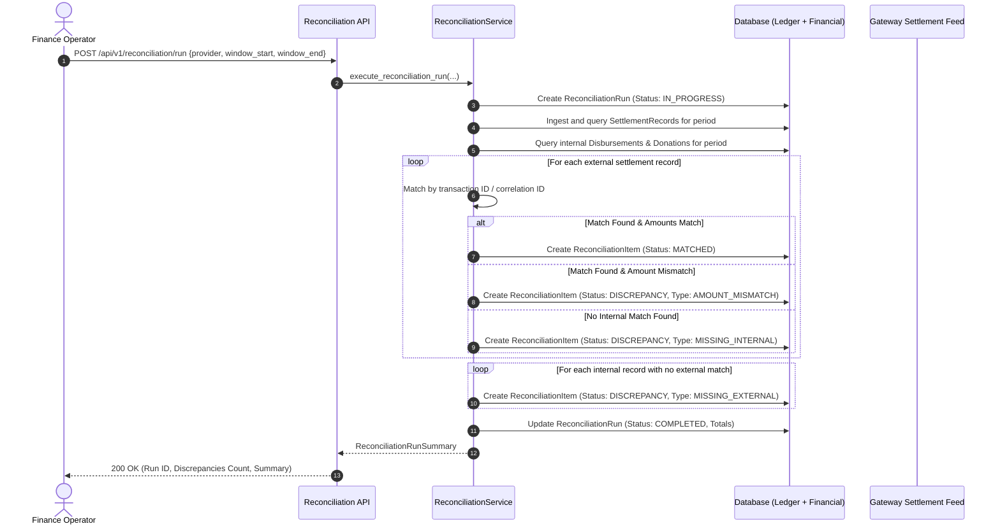

# Automated Financial Reconciliation Engine

## 1. Overview & Purpose

Financial integrity in CharityChain requires continuous, automated verification that internal application records, the double-entry general ledger, and external payment provider settlement reports match with zero variance.

The **Automated Financial Reconciliation Engine** periodically ingests external transaction feeds (from payment gateways like PayPal and banking partners), compares them against internal donations, disbursements, and ledger postings, classifies any discrepancies into a structured taxonomy, and tracks investigations to audited resolution.

---

## 2. Three-Way Reconciliation Architecture

CharityChain enforces a **Three-Way Reconciliation Model**:

```
+-----------------------------------+
| 1. Application Domain Records     |
| (Donations, Disbursements,        |
|  PayoutBatches)                   |
+-----------------+-----------------+
                  |
                  | Verified 1:1
                  v
+-----------------+-----------------+       Reconciled Against       +-----------------------------------+
| 2. Double-Entry General Ledger    | <============================> | 3. External Settlement Feeds      |
| (Journal Entries, Journal Lines,  |                                | (Settlement Records, Fee Records, |
|  Ledger Accounts)                 |                                |  Gateway Settlement Reports)      |
+-----------------------------------+                                +-----------------------------------+
```

1. **Application Domain Records**: High-level entity records tracking donor gifts, milestone releases, and batch runs.
2. **Double-Entry General Ledger**: Mathematical ledger guaranteeing debits equal credits for every financial transaction.
3. **External Settlement Feeds**: Raw transaction, settlement, and fee data received directly from payment processors and bank settlement files.

---

## 3. Discrepancy Taxonomy

The reconciliation engine categorizes every identified divergence using a standardized discrepancy taxonomy:

| Discrepancy Type | Code | Description | Automated Action | Severity |
| :--- | :--- | :--- | :--- | :--- |
| **Amount Mismatch** | `AMOUNT_MISMATCH` | Gateway settled amount differs from internal transaction or ledger amount. | Flagged, disbursement hold if outbound. | **Critical** |
| **Fee Mismatch** | `FEE_MISMATCH` | Processor fee differs from expected schedule or contract rate. | Flagged, fee adjustment entry drafted. | **Medium** |
| **Status Mismatch** | `STATUS_MISMATCH` | State divergence (e.g., local state `PENDING` but gateway `COMPLETED`, or local `COMPLETED` but gateway `DENIED`). | Automatic state sync if valid, alert if conflicting. | **High** |
| **Missing Internal** | `MISSING_INTERNAL` | Settlement report lists a transaction with no corresponding internal record in CharityChain. | Flagged as rogue or unlinked transaction. | **Critical** |
| **Missing External** | `MISSING_EXTERNAL` | Internal disbursement or capture is marked complete but not found in gateway settlement report after cutoff. | Flagged as potential settlement delay or ghost transaction. | **High** |
| **Timing Difference** | `TIMING_DIFFERENCE` | Transaction initiated near cutoff window; settled in subsequent batch. | Tracked across rolling reconciliation windows. | **Low** |

---

## 4. Reconciliation Engine Implementation

The reconciliation engine is implemented in `backend/app/services/reconciliation_service.py` and backed by the database models in `backend/app/db/models/financial.py`:

### Key Data Models:
- `ReconciliationRun`: Represents an execution of the reconciliation process over a defined date/time window and provider. Tracks summary metrics (`total_records_analyzed`, `matched_count`, `discrepancy_count`, `total_unmatched_amount_cents`, `status`).
- `ReconciliationItem`: An individual line item evaluated during a run. Records the internal record reference, external provider transaction ID, expected vs. actual amounts and fees, discrepancy classification, and human resolution notes.
- `SettlementRecord`: Raw ingested settlement records from gateway settlement files or APIs.
- `ProcessorFeeRecord`: Detailed fee breakdowns associated with settlement entries.

---

## 5. Execution Workflow



---

## 6. Discrepancy Resolution & Audit Trail

Discrepancies cannot be deleted or bypassed. Every discrepancy item must be resolved through an audited workflow:

1. **Investigation**: A financial administrator reviews the flagged item in the Financial Operations dashboard or via `GET /api/v1/reconciliation/runs/{id}`.
2. **Resolution Submission**:
   - The admin calls `POST /api/v1/reconciliation/runs/{run_id}/items/{item_id}/resolve`.
   - Body:
     ```json
     {
       "resolution_notes": "Vendor fee adjustment verified under revised contract amendment #104. Posted adjusting journal entry JE-2026-089.",
       "adjusting_journal_entry_id": "a1b2c3d4-..."
     }
     ```
3. **Audited State**:
   - The item status transitions to `RESOLVED`.
   - The resolver's user ID, resolution timestamp, and resolution notes are immutably stored.
   - Adjusting journal entries must maintain the double-entry invariant ($\sum D = \sum C$).

---

## 7. Automated Verification & Testing

The reconciliation engine is covered by automated unit and integration tests:
- `tests/integration/test_financial_reconciliation.py`: Tests clean matches, missing records, fee variance detection, and the resolution lifecycle.
- Zero floating-point calculations verified across settlement record comparisons.

