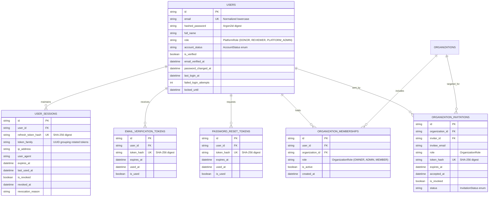

# CharityChain — Identity Database Design Specification
**Phase 2 Deliverable — Schema Extensions, Token Models, Constraints & Alembic Migration**

---

## 1. Identity & Session ER Diagram

---

## 2. Table Definitions & Constraint Rules

### 2.1 Table: `users` (Extended)
- `email`: Normalized lowercase string, indexed with unique B-tree index.
- `role`: PlatformRole enum (`DONOR`, `REVIEWER`, `PLATFORM_ADMIN`).
- `account_status`: AccountStatus enum (`PENDING_VERIFICATION`, `ACTIVE`, `LOCKED`, `SUSPENDED`, `DEACTIVATED`).
- `failed_login_attempts`: Integer counter tracking consecutive bad passwords.
- `locked_until`: Expiration timestamp for brute-force lockouts.

### 2.2 Table: `user_sessions`
- `refresh_token_hash`: Unique SHA-256 hash string (`VARCHAR(64)`). Plaintext refresh tokens are never persisted.
- `token_family`: Grouping identifier enabling complete family revocation upon replay attack detection.
- `is_revoked`: Boolean flag updated on rotation, logout, or security invalidation.

### 2.3 Table: `organization_memberships`
- Composite Unique Constraint: `UniqueConstraint('user_id', 'organization_id', name='uq_org_membership_user_org')` prevents duplicate memberships.
- `role`: OrganizationRole enum (`OWNER`, `ADMIN`, `MEMBER`).

### 2.4 Table: `organization_invitations`
- `token_hash`: Unique SHA-256 digest of URL-safe random string.
- Foreign Keys: Cascades on organization or inviter user deletion.

---

## 3. Alembic Forward Migration

The changes are captured in [`backend/alembic/versions/002_phase2_identity_and_auth.py`](file:///c:/Users/Meenal%20Sinha/Downloads/Charity-Chain/backend/alembic/versions/002_phase2_identity_and_auth.py):
- Adds columns to `users` with non-null server defaults.
- Adds `uq_org_membership_user_org` unique constraint.
- Creates `user_sessions`, `email_verification_tokens`, `password_reset_tokens`, and `organization_invitations` with appropriate foreign keys and performance indexes.
- Implements fully reversible `downgrade()` logic.

