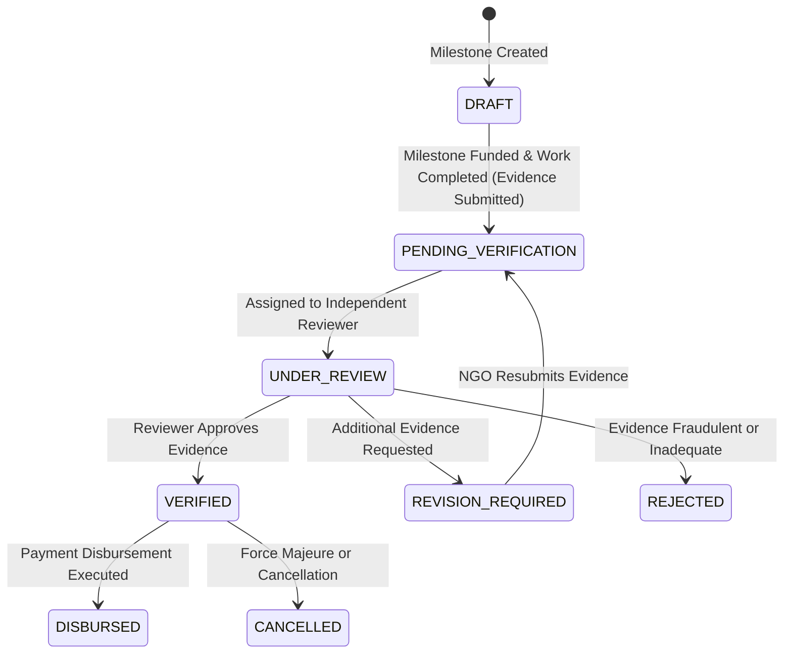

# CharityChain — Milestone Management Architecture & Verification Protocol

## 1. Executive Summary

In traditional charitable platforms, donations are disbursed as upfront lump sums with little to no proof of actual field delivery. CharityChain eliminates this moral hazard by decomposing projects into structured, phased **Milestones**.

Funds are tied to specific, measurable milestones. Financial release is strictly contingent upon:
1. Satisfactory delivery of promised deliverables.
2. Photographic and documentary evidence submission.
3. Multi-modal AI verification (EXIF/GPS Haversine validation, tamper/ELA detection, semantic consistency).
4. Independent human reviewer inspection and formal sign-off.

---

## 2. Milestone Sequence & Integrity Invariants

### 2.1 Contiguous Sequence Numbering (`1..N`)
Every project's milestones form an ordered, chronological sequence of execution stages. CharityChain enforces strict contiguous ordering:
- Sequence numbers start at index `1`.
- Intermediate sequence gaps are prohibited (e.g., sequences `[1, 2, 4]` will be rejected).
- Duplicate sequence numbers within a single project are strictly prohibited and prevented at both the application layer and database level via the unique composite constraint:
  ```sql
  CONSTRAINT uq_milestone_project_seq UNIQUE (project_id, sequence_number)
  ```
- When a milestone is removed from a draft project, subsequent sequence numbers are validated to ensure sequence continuity is maintained before submission.

### 2.2 Budget Allocation & Monetary Invariants
Every milestone defines a specific funding target represented in integer minor units (`target_amount_minor_units`):
- **Project Budget Ceiling**: The cumulative sum of all milestone target amounts must equal or be within the project's total funding target:
  $$\sum_{i=1}^{N} \text{Milestone}_i.\text{target\_amount} \le \text{Project}.\text{funding\_target}$$
- **Excess Allocation Guard**: Adding or updating a milestone that causes the total milestone allocations to exceed the project budget triggers an immediate `ValidationException("Milestone funding targets exceed project funding target")`.
- **Currency Homogeneity**: All milestones inherit and must strictly match the project's ISO 4217 currency code (e.g., `USD`, `EUR`, `GBP`, `INR`). Multi-currency mixing within a single project is prohibited.
- **Minimum Allocation**: Every milestone must have a funding target greater than zero minor units.

---

## 3. Deliverables, Outcomes & Acceptance Criteria Specification

To ensure objective verifiability by both AI models and human reviewers, each milestone requires comprehensive domain fields:

| Field Name | Type | Constraints | Description |
|---|---|---|---|
| `sequence_number` | Integer | $\ge 1$, contiguous | Chronological position of the milestone. |
| `title` | String | 3–150 chars | Concise summary of the milestone stage. |
| `objective` / `description` | Text | $\ge 10$ chars | Detailed narrative of what will be achieved. |
| `deliverables` | JSON / Text | Required | Specific tangible assets or outputs produced (e.g., "5 Borehole wells drilled", "200 text books distributed"). |
| `expected_outcome` | Text | Required | Quantifiable social or environmental impact expected upon completion. |
| `success_criteria` | Text | Required | Explicit criteria required for reviewer approval and fund release. |
| `target_amount_minor_units` | Integer | $> 0$ | Milestone funding allocation in minor units (e.g., cents). |
| `target_latitude` | Float | $-90.0 \le \text{lat} \le 90.0$ | Optional target GPS latitude for field operations. |
| `target_longitude` | Float | $-180.0 \le \text{lng} \le 180.0$ | Optional target GPS longitude for field operations. |

---

## 4. Geolocation Validation & Site Verification

For field-based physical projects (e.g., rural infrastructure, clean water wells, reforestation, disaster relief):
1. **Coordinate Bounding Box**: Coordinates provided on milestones are validated against geographic coordinate bounds:
   - Latitude: $-90.0^\circ$ to $+90.0^\circ$
   - Longitude: $-180.0^\circ$ to $+180.0^\circ$
2. **Field Evidence Matching (Phase 5 & 6 Interface)**:
   - Evidence photographs submitted for a milestone must contain authentic EXIF GPS tags.
   - CharityChain calculates the Haversine distance between the milestone's target coordinates and the photo's EXIF location:
     $$d = 2r \arcsin\left(\sqrt{\sin^2\left(\frac{\Delta \phi}{2}\right) + \cos(\phi_1)\cos(\phi_2)\sin^2\left(\frac{\Delta \lambda}{2}\right)}\right)$$
   - Discrepancies exceeding the geofence threshold (e.g., > 5 km) flag the submission for elevated reviewer scrutiny.

---

## 5. Milestone Lifecycle State Machine

Milestones advance through a deterministic state machine managed by `StateMachineValidator`:



### State Definitions:
- `DRAFT`: Milestone is defined within a draft or active project, awaiting funding and physical execution.
- `PENDING_VERIFICATION`: The NGO has completed the work, uploaded required evidence, and submitted the milestone for verification.
- `UNDER_REVIEW`: An independent, unconflicted reviewer is examining the submitted evidence and AI verification findings.
- `VERIFIED`: The reviewer has verified the evidence and approved the milestone for financial release.
- `REVISION_REQUIRED`: The reviewer requested clearer photos, additional receipts, or supplementary reports.
- `REJECTED`: The evidence failed inspection or indicated fraudulent activity.
- `DISBURSED`: Milestone funds have been released to the NGO's payout account (Phase 8).

---

## 6. Pre-Submission Checklist Enforcement

During project pre-submission evaluation (`ProjectService.validate_project_submission`), milestones are subjected to 5 distinct automated validation checks:
1. **`NO_MILESTONES`**: The project must have at least one defined milestone.
2. **`MILESTONE_BUDGET_MISMATCH`**: The total milestone allocations must not exceed the overall project funding target.
3. **`MILESTONE_SEQUENCE_GAP`**: Milestone sequence numbers must be contiguous starting from `1` with no skips.
4. **`MILESTONE_MISSING_DELIVERABLES`**: Every milestone must clearly define tangible deliverables.
5. **`INVALID_COORDINATES`**: If target coordinates are supplied, they must be valid numeric degrees within standard limits.

Any failure prevents project submission and returns an actionable diagnostics report with field-level error messages to the NGO dashboard.
