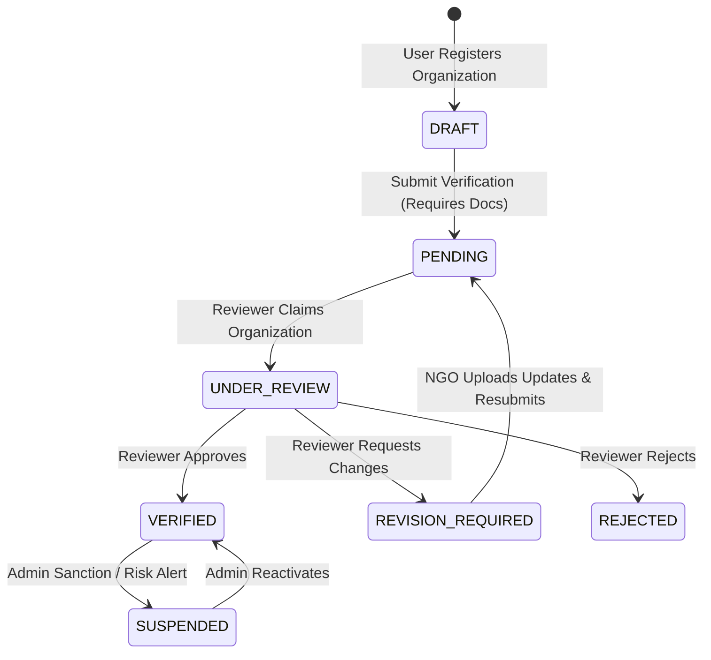

# CharityChain — Organization Management Architecture

## 1. Overview
Organization Management in CharityChain provides a multi-tenant, identity-governed foundation for Non-Governmental Organizations (NGOs), charities, and non-profit institutions. Rather than operating as flat, unverified user accounts, organizations represent legally distinct entities that own charitable projects, manage multi-milestone initiatives, submit verification documentation, and delegate responsibilities across scoped organizational roles.

---

## 2. Organization Data Model

Organizations are modeled in the database via the `organizations` table (`backend/app/db/models/users.py`), enriched in Phase 3 with rigorous legal, operational, and verification tracking fields:

| Field | Type | Description |
|---|---|---|
| `id` | String(36) PK | Cryptographic UUIDv4 primary key |
| `name` | String(255) Unique | Unique operational organization handle |
| `legal_name` | String(255) | Official legal entity registration name |
| `display_name` | String(255) | Public-facing brand name |
| `organization_type` | Enum | Legal structure classification (`NON_PROFIT`, `CHARITY`, `NGO`, etc.) |
| `country` | String(3) | Primary country of registration (ISO-3166-1 alpha-2 / alpha-3) |
| `registration_number`| String(100) Unique | Official government registry identifier |
| `registration_authority`| String(255) | Governing agency (e.g., UK Charity Commission, US IRS) |
| `registration_date` | DateTime | Official date of legal formation |
| `tax_id` | String(100) | Tax identification number / EIN |
| `classification` | String(100) | Regulatory classification (e.g., 501(c)(3)) |
| `registered_address`| Text | Official domicile address for legal correspondence |
| `operating_address` | Text | Primary physical operations facility |
| `primary_operating_region` | String(255) | Geographic domain of intervention |
| `official_email` | String(255) | Monitored organizational contact inbox |
| `official_phone` | String(32) | Monitored voice contact number |
| `website` | String(255) | Verified official web domain |
| `mission_statement` | Text | Core humanitarian / conservation objective |
| `vision` | Text | Long-term operational vision |
| `focus_areas` | JSON | Normalized sector tags (e.g., Education, Reforestation) |
| `operating_regions` | JSON | List of countries or administrative regions served |
| `beneficiary_categories` | JSON | Target demographic groups served |
| `years_of_operation`| Integer | Documented operational history |
| `status` | Enum | Lifecycle status (`DRAFT`, `PENDING`, `UNDER_REVIEW`, `VERIFIED`, `REVISION_REQUIRED`, `REJECTED`, `SUSPENDED`) |
| `reviewer_id` | String(36) FK | Foreign key to `users.id` of the reviewing officer |
| `verified_at` | DateTime | Timestamp of formal verification decision |
| `created_at` / `updated_at` | DateTime | Audit tracking timestamps |

---

## 3. Legal Structure Classifications

CharityChain recognizes 5 core institutional types via `OrganizationType`:

1. **`NON_PROFIT`**: General incorporated non-profit organizations governed by board trustees.
2. **`CHARITY`**: Formally registered charities subject to statutory public benefit requirements (e.g., UK Charity Commission, Scottish Charity Regulator).
3. **`NGO`**: Non-Governmental Organizations operating domestically or internationally on humanitarian, environmental, or social missions.
4. **`COMMUNITY_INTEREST_COMPANY`**: Social enterprises whose assets and profits are dedicated to community benefit.
5. **`FOUNDATION`**: Grant-making or operating charitable trusts and endowments.

---

## 4. Multi-Tenant Isolation Architecture

Multi-tenancy is enforced at the domain service and database query layer:
- **Tenant Scope**: Every project, milestone, and verification document is explicitly bound to an `organization_id`.
- **Inherent IDOR Defense**: The service layer (`NGOOnboardingService._get_org_and_verify_membership` and `ProjectService._verify_org_membership`) inspects caller identity against `organization_memberships`.
- **Rejection of Foreign Actors**: Even if an attacker knows the UUID of an organization, any attempt to read private documents, modify details, create projects, or attach milestones raises `ForbiddenException` unless the caller is an active member with appropriate role privileges.

---

## 5. Organizational Role-Based Access Control (RBAC)

CharityChain separates platform-wide roles (`PlatformRole`: `DONOR`, `REVIEWER`, `PLATFORM_ADMIN`) from organization-scoped roles (`OrganizationRole`):

1. **`OWNER`**:
   - Creator of the organization (assigned atomically upon registration).
   - Full authority to update legal profile, upload verification documents, submit for verification, create/manage projects, and invite members.
   - Protected by **Last Owner Defense**: An organization's last active owner cannot be removed or demoted.
2. **`ADMIN`**:
   - Delegated organizational administrator.
   - Authority to draft projects, add milestones, submit projects for review, and upload operational documents.
3. **`MEMBER`**:
   - Operational staff or collaborator.
   - Read access to draft organizational projects; cannot submit organizations for verification or delete milestones.

---

## 6. Onboarding Lifecycle Workflows

1. **Registration**: Authenticated user submits `CreateOrganizationRequest`. The organization is created in `DRAFT` status and user is assigned `OWNER`.
2. **Documentation**: Owner uploads required proof of legal registration (`REGISTRATION_CERTIFICATE`, `TAX_EXEMPTION_CERTIFICATE`, etc.).
3. **Submission**: Owner calls `submit_verification`. Status transitions to `PENDING`.
4. **Review**: Independent reviewer inspects queue and decides (`VERIFIED`, `REVISION_REQUIRED`, or `REJECTED`).
5. **Project Capability**: Only `VERIFIED` organizations are permitted to have projects submitted and activated for public discovery.
