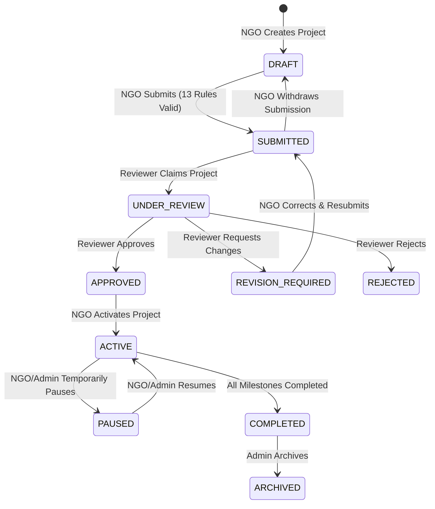

# CharityChain — Multi-Milestone Project Management Architecture

## 1. Overview
CharityChain treats charitable projects not as one-off fundraisers, but as structured, phased impact initiatives. Every project consists of an overarching budget, strategic objectives, and multiple concrete milestones. Funds cannot be released in lump sums; donations are conditionally locked against specific milestones and released only upon verified evidence of real-world completion.

---

## 2. Project Lifecycle State Machine

Projects progress through a formal, governed state machine enforced by `StateMachineValidator`:



### Transition Authority Matrix:
| From State | To State | Permitted Roles | Business Purpose |
|---|---|---|---|
| `DRAFT` | `SUBMITTED` | Org `OWNER`, `ADMIN` | Submit complete project for inspection |
| `SUBMITTED` | `DRAFT` | Org `OWNER`, `ADMIN` | Withdraw submission to make edits |
| `SUBMITTED` | `APPROVED` | `REVIEWER`, `PLATFORM_ADMIN` | Approve project for launch |
| `SUBMITTED` | `REVISION_REQUIRED` | `REVIEWER`, `PLATFORM_ADMIN` | Request changes to milestones/budget |
| `REVISION_REQUIRED`| `SUBMITTED` | Org `OWNER`, `ADMIN` | Resubmit corrected project |
| `SUBMITTED` | `REJECTED` | `REVIEWER`, `PLATFORM_ADMIN` | Reject ineligible project |
| `APPROVED` | `ACTIVE` | Org `OWNER`, `ADMIN` | Activate project for public discovery |
| `ACTIVE` | `PAUSED` | Org `OWNER`, `ADMIN`, Admin | Temporarily halt contributions/actions |
| `PAUSED` | `ACTIVE` | Org `OWNER`, `ADMIN`, Admin | Resume active project operations |
| `ACTIVE` | `COMPLETED` | Org `OWNER`, `ADMIN`, Admin | Mark all deliverables completed |
| `COMPLETED`| `ARCHIVED` | `PLATFORM_ADMIN` | Long-term archival |

---

## 3. The 13-Rule Pre-Submission Validation Checklist

Before an organization can transition a project from `DRAFT` to `SUBMITTED`, the project is evaluated against 13 strict business rules implemented in `ProjectService.validate_project_submission`:

1. **Organization Verification Rule (`ORG_NOT_VERIFIED`)**: The sponsoring organization must be in `VERIFIED` status.
2. **Organization Active Rule (`ORG_SUSPENDED`)**: The organization must not be in `SUSPENDED` status.
3. **Title Length Rule (`TITLE_TOO_SHORT`)**: Project title must be at least 3 characters and not empty.
4. **Summary Quality Rule (`SUMMARY_TOO_SHORT`)**: Executive summary must be at least 10 characters long.
5. **Clear Objectives Rule (`OBJECTIVES_REQUIRED`)**: Project must have defined objectives (minimum 10 characters).
6. **Positive Budget Rule (`INVALID_TARGET_AMOUNT`)**: Overall funding target must be strictly greater than zero.
7. **Supported Currency Rule (`UNSUPPORTED_CURRENCY`)**: Project currency must be supported in `settings.SUPPORTED_CURRENCIES` (USD, EUR, GBP, ETH).
8. **Valid Timeline Rule (`INVALID_TIMELINE`)**: Planned end date cannot precede planned start date.
9. **Minimum Milestones Rule (`MILESTONES_REQUIRED`)**: Project must contain at least 1 defined milestone.
10. **Budget Allocation Rule (`BUDGET_MISMATCH`)**: The sum of milestone funding targets must match the project funding target (minor unit precision).
11. **Currency Uniformity Rule (`CURRENCY_MISMATCH`)**: Every milestone's currency must match the project's base currency.
12. **Milestone Sequence Integrity (`SEQUENCE_GAP` / `DUPLICATE_SEQUENCE`)**: Milestones must form a contiguous sequence starting at 1 (1, 2, 3...) without gaps or duplicates.
13. **Geographic Feasibility Rule (`INVALID_COORDINATES`)**: If GPS coordinates are provided on project or milestones, latitude must be between [-90, 90] and longitude between [-180, 180].

### Structured Validation Report DTO
```json
{
  "valid": false,
  "can_submit": false,
  "issues": [
    {
      "field": "milestones",
      "code": "BUDGET_MISMATCH",
      "message": "Total milestone allocations ($12,000.00) do not equal project funding target ($20,000.00)."
    }
  ]
}
```

---

## 4. Public Discovery and Visibility Controls

Projects are discovered through `ProjectService.discover_projects` (`GET /projects`):
- **Visibility Gates**: Only projects meeting all four criteria are returned:
  1. `Project.status == ProjectStatus.ACTIVE`
  2. `Project.public_visibility == ProjectVisibility.PUBLIC`
  3. `Organization.status == OrganizationStatus.VERIFIED`
  4. `Project.is_archived == False`
- **Filtering Capabilities**:
  - Full-text search across `title`, `summary`, and `description`.
  - Category slug / ID filtering.
  - Country of operation (ISO-2 / ISO-3).
  - Target budget bounds (`min_target`, `max_target`).
  - Standard pagination with metadata (`page`, `page_size`, `total_items`, `total_pages`).

