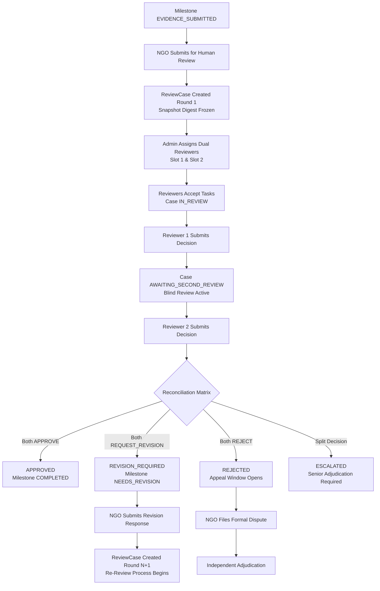

# CharityChain — Human Review & Decision Workflows Specification

## 1. Overview & System Rationale

In CharityChain, financial releases are bound directly to verifiable real-world impact. While Phase 6 provides an advanced AI Evidence Verification Engine that performs computer vision analysis, image forensics, geospatial validation, and cross-evidence comparison, **AI findings remain strictly advisory**.

Final milestone decisions and approvals are governed by an independent, accountable human review layer introduced in **Phase 7**. This document details the lifecycle, business rules, and state transitions of human review cases.

---

## 2. Milestone Review Lifecycle

### Step 1: Submission & Evidence Snapshot Freezing
When an NGO completes a milestone and uploads required evidence assets, an authorized organization representative submits the milestone for human review via `/api/v1/reviews/cases/milestone/{id}/submit`.

During submission:
1. **Evidence Binding**: All active, unarchived evidence files associated with the milestone are captured.
2. **Snapshot Digest Computation**: A deterministic SHA-256 digest is generated from the sorted tuple of evidence file IDs, version numbers, and file hashes:
   $$\text{Digest} = \text{SHA-256}\left(\bigoplus_{i} \left(\text{ID}_i \parallel \text{Version}_i \parallel \text{Hash}_i\right)\right)$$
3. **AI Report Association**: The latest completed AI verification reports for each evidence file are bound into the review case evidence table (`review_case_evidence`).
4. **Milestone State**: The milestone transitions to `VERIFICATION_PENDING`.

### Step 2: Dual Reviewer Assignment
A platform administrator assigns two independent, non-conflicted reviewers to the case using `/api/v1/reviews/cases/{id}/assign`:
- **Slot 1**: Primary Reviewer
- **Slot 2**: Secondary Reviewer

The system enforces strict conflict-of-interest (COI) pre-checks, verifying that neither reviewer is an organization member, project creator, case submitter, evidence uploader, or already assigned to another slot.

### Step 3: Task Acceptance & Blind Review
Each assigned reviewer receives a notification in their reviewer queue. Upon inspecting task details, the reviewer either:
- **Accepts Assignment**: Transitions the task state to `ACCEPTED` and the case to `IN_REVIEW`.
- **Declines Assignment**: Provides a mandatory documented reason, transitioning the task to `DECLINED` for administrative reassignment.
- **Declares Conflict of Interest**: Explains an unforeseen COI, immediately unassigning the reviewer.

### Step 4: Decision Submission & Anchoring Elimination
Reviewers independently inspect:
- Original evidence assets (images, PDFs, documents).
- Cryptographic content hashes and timestamps.
- AI Verification Engine findings (authenticity score, metadata consistency, tampering flags).
- Milestone description, acceptance criteria, and geographic target bounds.

Each reviewer submits one of three decisions:
1. **`APPROVE`**: Evidence satisfies all milestone objectives.
2. **`REQUEST_REVISION`**: Evidence is incomplete, ambiguous, or requires clarification (mandatory structured requirements).
3. **`REJECT`**: Milestone fails to satisfy requirements, exhibits unresolved fraud, or violates project guidelines.

**Blind Review Protection**: To prevent cognitive anchoring and social pressure, Reviewer 2 cannot see Reviewer 1's decision, comments, or score until Reviewer 2 has submitted their own decision.

### Step 5: Dual-Key Reconciliation
Upon receipt of the second decision, the system automatically evaluates the reconciliation matrix:
- **Concurring Approvals**: Case transitions to `APPROVED`, milestone transitions to `COMPLETED`.
- **Concurring Revision Requests**: Case transitions to `REVISION_REQUIRED`, milestone transitions to `REVISION_REQUIRED`, deadline is assigned.
- **Concurring Rejections**: Case transitions to `REJECTED`, milestone transitions to `REJECTED`, formal appeal window opens.
- **Split Decisions**: Case transitions to `ESCALATED` for senior administrative adjudication.

---

## 3. Scope Boundaries & Deferrals

- **Phase 8 Strict Boundary**: Human review approval completes the milestone and records verified impact. It does **NOT** disburse funds, trigger PayPal payouts, or execute financial ledger debits. Disbursement is handled exclusively in Phase 8.
- **Proof-of-Impact**: Public cryptographic certificates and NFT minting are deferred to Phase 9.
- **External Notifications**: Direct transactional email dispatch and external webhook invocations are deferred to Phase 10.
