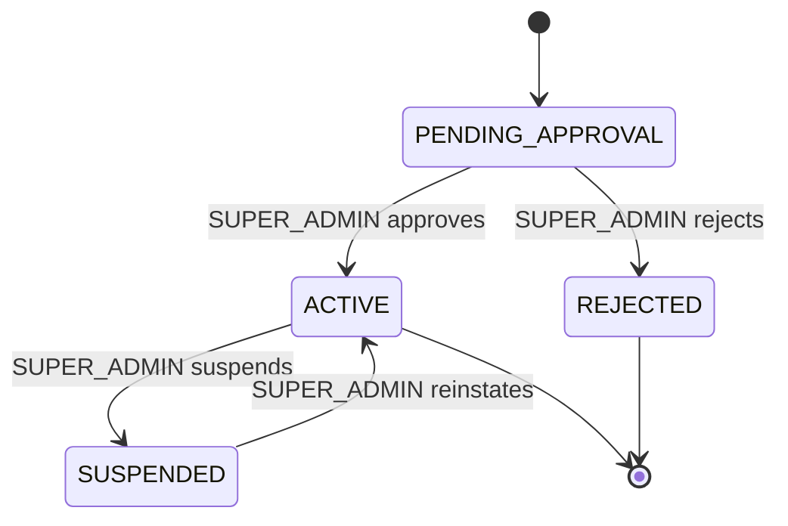
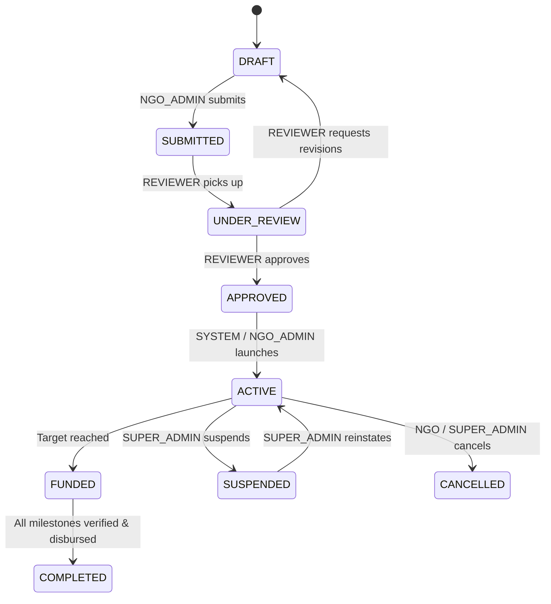
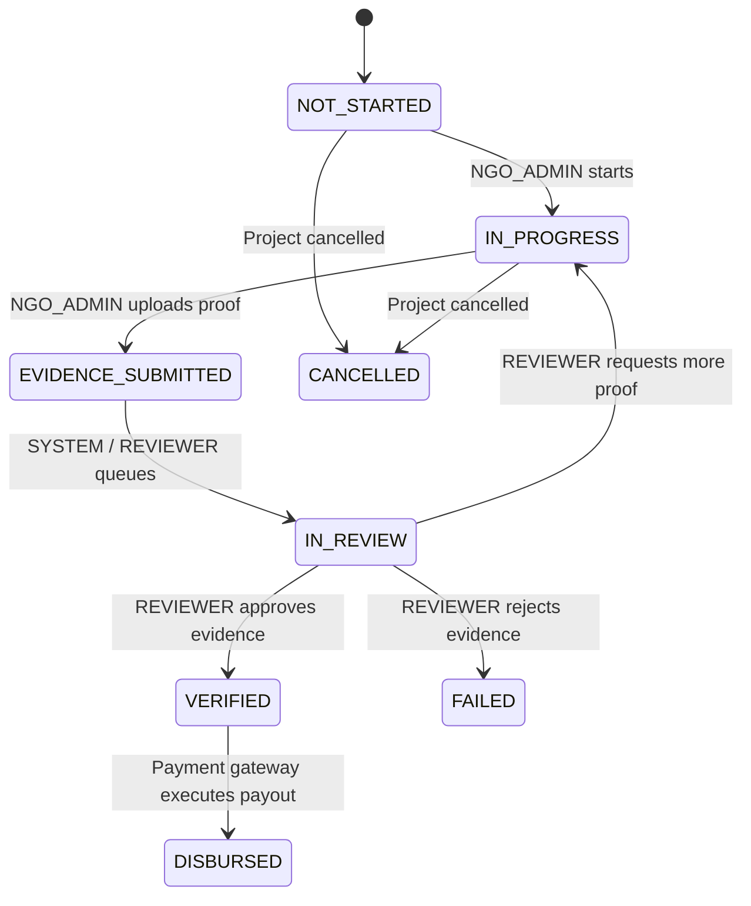
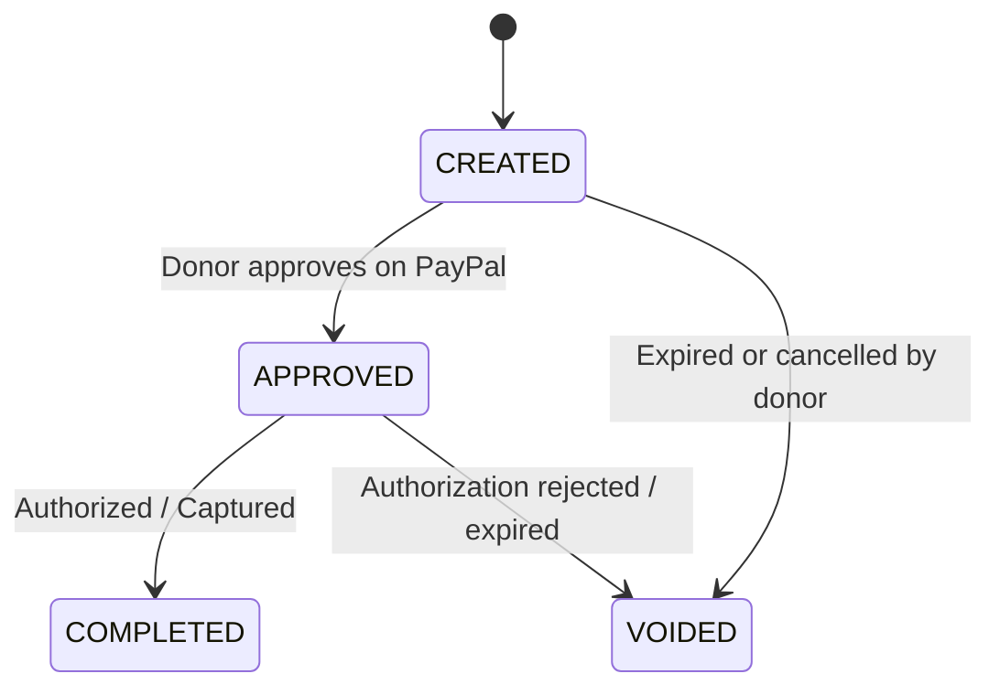
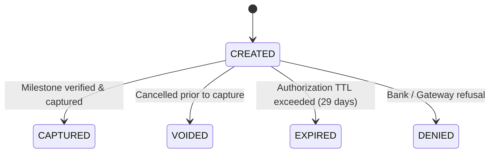
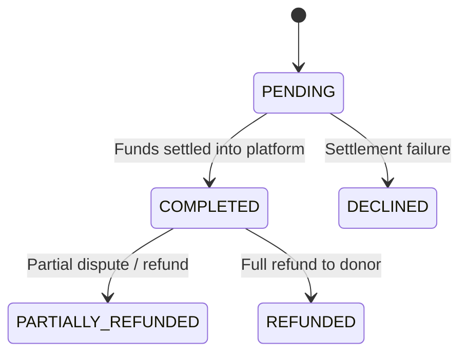
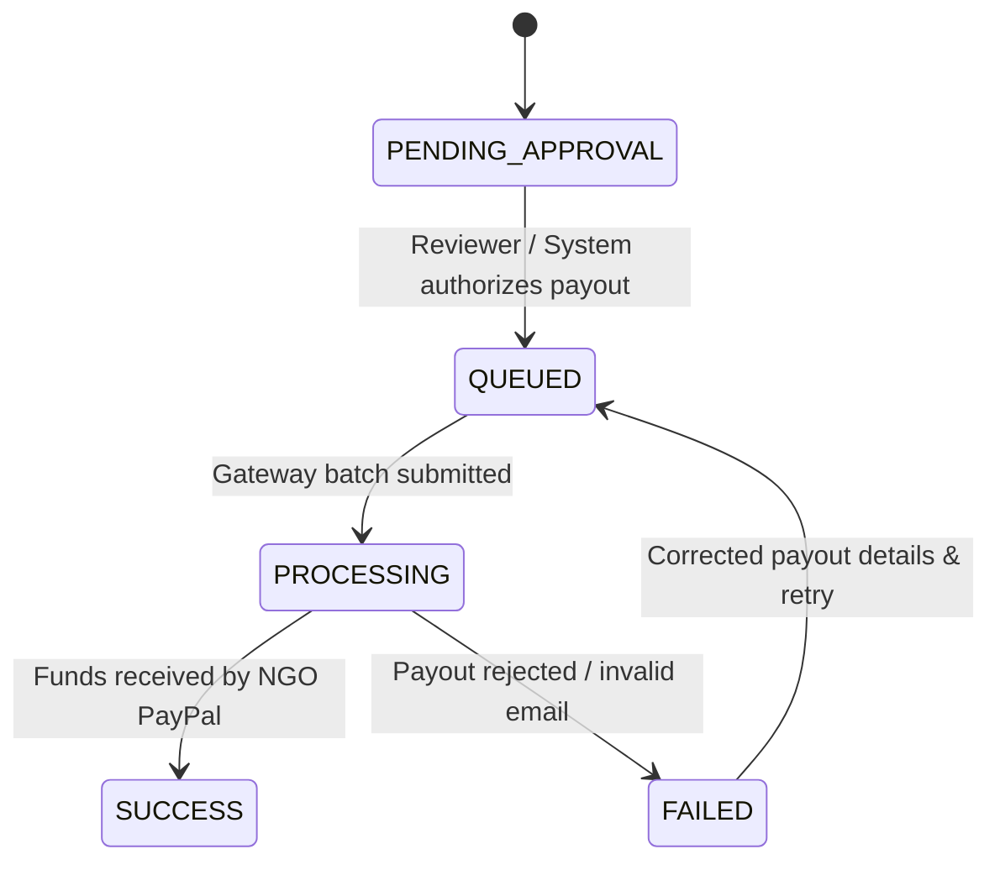

# CharityChain — State Machine Specification
**Phase 1 Deliverable — Deterministic Lifecycles, Valid Transitions & Role Enforcement**

---

## 1. State Machine Enforcement Architecture

To guarantee platform integrity, all domain entities with lifecycles are governed by deterministic finite state machines implemented in `backend/app/core/state_machines.py`.
- **Validation**: Every attempted state transition is validated against a pre-compiled set of valid destination states.
- **Role Authorization**: Each transition requires an authorized caller role (`DONOR`, `NGO_ADMIN`, `REVIEWER`, `SUPER_ADMIN`, or `SYSTEM`).
- **Fail-Fast Error Handling**: Illegal transitions immediately abort the transaction and raise `InvalidStateTransitionException` (HTTP 400).
- **Audit Emission**: Every valid state change automatically writes an append-only `AuditEvent` record.

---

## 2. Organization Lifecycle

| Current State | Target State | Authorized Actor | Preconditions / Invariants |
|---|---|---|---|
| `PENDING_APPROVAL` | `ACTIVE` | `SUPER_ADMIN` | Legal documents verified, tax ID validated |
| `PENDING_APPROVAL` | `REJECTED` | `SUPER_ADMIN` | Rejection reason recorded |
| `ACTIVE` | `SUSPENDED` | `SUPER_ADMIN` | Investigation or compliance issue |
| `SUSPENDED` | `ACTIVE` | `SUPER_ADMIN` | Compliance issue resolved |

---

## 3. Project Lifecycle

| Current State | Target State | Authorized Actor | Preconditions / Invariants |
|---|---|---|---|
| `DRAFT` | `SUBMITTED` | `NGO_ADMIN` | Must have >= 1 milestone and valid location |
| `SUBMITTED` | `UNDER_REVIEW` | `REVIEWER`, `SUPER_ADMIN` | Assigned to a specific reviewer |
| `UNDER_REVIEW` | `APPROVED` | `REVIEWER`, `SUPER_ADMIN` | Due diligence passed |
| `UNDER_REVIEW` | `DRAFT` | `REVIEWER`, `SUPER_ADMIN` | Revisions required |
| `APPROVED` | `ACTIVE` | `NGO_ADMIN`, `SUPER_ADMIN` | Campaign opened for donations |
| `ACTIVE` | `FUNDED` | `SYSTEM` | Total captured donations >= target amount |
| `FUNDED` | `COMPLETED` | `SYSTEM`, `SUPER_ADMIN` | 100% of milestones `DISBURSED` |
| `ACTIVE` | `SUSPENDED` | `SUPER_ADMIN` | Investigation trigger |
| `ACTIVE` | `CANCELLED` | `NGO_ADMIN`, `SUPER_ADMIN` | Donors queued for refund |

---

## 4. Milestone Lifecycle

| Current State | Target State | Authorized Actor | Preconditions / Invariants |
|---|---|---|---|
| `NOT_STARTED` | `IN_PROGRESS` | `NGO_ADMIN` | Previous milestone verified (if sequential) |
| `IN_PROGRESS` | `EVIDENCE_SUBMITTED` | `NGO_ADMIN` | At least 1 valid evidence file uploaded |
| `EVIDENCE_SUBMITTED`| `IN_REVIEW` | `SYSTEM`, `REVIEWER` | AI verification report generated |
| `IN_REVIEW` | `VERIFIED` | `REVIEWER`, `SUPER_ADMIN` | Human reviewer signs approval record |
| `IN_REVIEW` | `FAILED` | `REVIEWER`, `SUPER_ADMIN` | Human reviewer records rejection rationale |
| `IN_REVIEW` | `IN_PROGRESS` | `REVIEWER`, `SUPER_ADMIN` | Feedback given, evidence window reopened |
| `VERIFIED` | `DISBURSED` | `SYSTEM`, `SUPER_ADMIN` | Payout confirmed by PayPal Payouts API |

---

## 5. Financial & Payment Lifecycles

### 5.1 Payment Order

### 5.2 Payment Authorization (Holding Escrow)

### 5.3 Payment Capture (Settlement)

### 5.4 NGO Disbursement

---

## 6. Evidence & Human Review Lifecycles

### 6.1 Evidence File
- `UPLOADED` -> Input hardened, MIME verified, SHA-256 hashed.
- `ANALYZED` -> Processed by AI forensic suite; `VerificationReport` created.
- `REJECTED` -> Marked invalid due to file tampering or irrelevance.
- `ARCHIVED` -> Project completed or cancelled.

### 6.2 Review Task
- `PENDING_REVIEW` -> Initial state upon evidence upload and AI report creation.
- `IN_REVIEW` -> Claimed by an authorized human reviewer.
- `DECIDED` -> `ReviewDecisionRecord` signed (`APPROVED`, `REJECTED`, or `MORE_INFO_REQUESTED`).
- `CANCELLED` -> Milestone or project cancelled.

