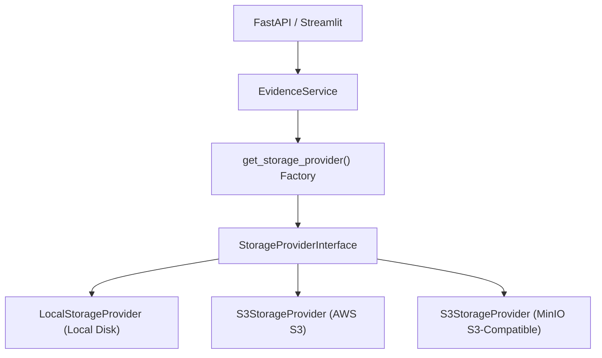

# Storage Architecture Specification

## 1. Architectural Overview

CharityChain employs a hexagonal storage pattern decoupled through the abstract interface `StorageProviderInterface`. The application core and domain services interact with storage exclusively through standardized synchronous contracts, ensuring clean transactional alignment with SQLAlchemy ORM sessions.



---

## 2. Interface Contract (`StorageProviderInterface`)

The interface contract is defined in `backend/app/integrations/storage/base.py`:

```python
class StorageProviderInterface(ABC):
    @abstractmethod
    def upload_file(
        self,
        file_bytes: bytes,
        filename: str,
        mime_type: str,
        subfolder: Optional[str] = None
    ) -> Tuple[str, str, str, int]:
        """
        Persists file bytes safely and returns:
        (storage_key, access_url_or_relative_path, sha256_hash, file_size_bytes)
        """
        pass

    @abstractmethod
    def get_file(self, storage_key: str) -> bytes:
        """Retrieves raw file bytes by storage key."""
        pass

    @abstractmethod
    def delete_file(self, storage_key: str) -> bool:
        """Deletes file from storage."""
        pass

    @abstractmethod
    def generate_access_url(self, storage_key: str, expires_in_seconds: int = 3600) -> str:
        """Generates a secure presigned or relative access URL."""
        pass

    @abstractmethod
    def verify_content_integrity(self, storage_key: str, expected_sha256: str) -> bool:
        """Verifies stored content matches cryptographic hash."""
        pass

    @abstractmethod
    def get_metadata(self, storage_key: str) -> Dict[str, Any]:
        """Retrieves metadata for stored object (e.g. size, content_type)."""
        pass
```

---

## 3. Storage Provider Implementations

### A. `LocalStorageProvider` (`backend/app/integrations/storage/local.py`)
- **Use Case**: Development, integration testing, offline on-premise environments.
- **Base Directory**: Configured via `STORAGE_LOCAL_DIR` (`data/evidence`) and `STORAGE_DOCUMENTS_DIR` (`data/documents`).
- **Path Traversal Defense**:
  ```python
  clean_key = os.path.normpath(storage_key).replace("\\", "/").lstrip("/")
  target = (self.base_dir / clean_key).resolve()
  target.relative_to(self.base_dir)  # Raises ValueError if path escapes base_dir
  ```
- **Access URLs**: Generates internal API download routes (`/api/v1/evidence/{key}/download`).

### B. `S3StorageProvider` (`backend/app/integrations/storage/s3.py`)
- **Use Case**: Production AWS deployments and MinIO local S3 emulation.
- **Client Configuration**: Uses `boto3.client("s3", ...)` with `signature_version="s3v4"`.
- **MinIO Support**: Dynamically configured by specifying `S3_ENDPOINT_URL` (e.g. `http://localhost:9000`).
- **Presigned URLs**: Generates secure time-bounded GET URLs without revealing AWS credentials:
  ```python
  url = self._s3.generate_presigned_url(
      ClientMethod="get_object",
      Params={"Bucket": self.bucket_name, "Key": storage_key},
      ExpiresIn=expires_in_seconds  # Configurable between 60s and 86400s
  )
  ```
- **Object Metadata**: Automatically persists `sha256` checksum and `original_filename` in S3 object user metadata headers.

---

## 4. Factory & Dependency Injection (`backend/app/integrations/storage/factory.py`)

The global factory dynamically instantiates the correct provider based on `settings.STORAGE_PROVIDER`:

```python
def get_storage_provider() -> StorageProviderInterface:
    global _storage_instance
    if _storage_instance is not None:
        return _storage_instance

    provider_type = settings.STORAGE_PROVIDER.lower()
    if provider_type in ("s3", "minio"):
        _storage_instance = S3StorageProvider()
    else:
        _storage_instance = LocalStorageProvider(base_dir=settings.STORAGE_LOCAL_DIR)

    return _storage_instance
```

### Test Mock Injection
Unit and integration tests can inject custom mock providers using:
```python
set_storage_provider(custom_mock)
# Execute tests...
reset_storage_provider()
```

---

## 5. Configuration Reference

| Environment Variable | Type | Default | Description |
| :--- | :--- | :--- | :--- |
| `STORAGE_PROVIDER` | `local` \| `s3` \| `minio` | `local` | Active storage provider backend. |
| `STORAGE_LOCAL_DIR` | Path | `data/evidence` | Target directory for local evidence files. |
| `STORAGE_DOCUMENTS_DIR` | Path | `data/documents` | Target directory for NGO onboarding documents. |
| `MAX_UPLOAD_SIZE_MB` | Float | `10.0` | Maximum single-file upload size. |
| `MAX_UPLOAD_BATCH_SIZE` | Integer | `10` | Maximum files per batch upload request. |
| `PRESIGNED_URL_EXPIRATION_SECONDS` | Integer | `3600` | Validity window for presigned URLs (60s to 86400s). |
| `S3_ENDPOINT_URL` | String | `None` | Custom endpoint for MinIO (e.g. `http://localhost:9000`). |
| `S3_ACCESS_KEY` | String | `None` | AWS / MinIO Access Key ID. |
| `S3_SECRET_KEY` | String | `None` | AWS / MinIO Secret Access Key. |
| `S3_BUCKET_NAME` | String | `charitychain-evidence` | S3 bucket name. |
| `S3_REGION` | String | `us-east-1` | AWS S3 region. |

